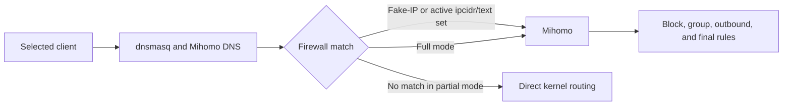

# Choosing a Routing Mode

[Documentation](../README.md)

JustClash supports two interception modes. The choice determines which connections reach Mihomo; rules inside Mihomo cannot affect traffic that the firewall never intercepted.

For the meaning of outbounds, providers, and groups, see
[Configure routing](../guides/routing.md#how-the-components-fit-together).

## Quick Decision

Choose **Partial Interception** when:

- only selected domains or address lists should enter Mihomo;
- most traffic should remain in the kernel fast path;
- the router has limited CPU or memory;
- unmatched real-address connections may remain direct.

Choose **Full Interception** when:

- every eligible TCP/UDP connection must be evaluated by Mihomo;
- the default rule must affect all eligible traffic;
- raw-address applications must follow GEOIP or IP rules;
- dashboard visibility is needed for all eligible connections.

## Data Path



DNS selects configured domain traffic for the Fake-IP path. In Partial
Interception, nftables also selects manual destination/source address rules and
active `ipcidr/text` rulesets. Binary IP-CIDR or GeoIP databases are not converted
into kernel sets.

## Behavior Comparison

| Behavior | Partial Interception | Full Interception |
| --- | --- | --- |
| Fake-IP domain traffic | Intercepted | Intercepted |
| Active `ipcidr/text` rulesets | Synchronized to nftables and intercepted | Evaluated by Mihomo |
| Binary IP-CIDR rulesets | Do not capture otherwise-unmatched raw addresses | Evaluated by Mihomo |
| Manual source/destination address rules | Included in interception sets | Evaluated by Mihomo |
| Unmatched real-address traffic | Direct kernel routing | Evaluated by Mihomo |
| Final `MATCH` rule | Intercepted traffic only | All eligible TCP/UDP traffic |
| Raw-address GEOIP policy | Incomplete | Available |
| Dashboard visibility | Intercepted connections only | All eligible TCP/UDP connections |
| Typical resource use | Lower | Higher |

Eligibility depends on the intercepted interfaces, exclusions, address family,
and private/local destination bypasses. Full Interception does not capture every
packet on the router.

## Partial Interception

Partial mode creates nftables sets from enabled text IP-CIDR rulesets and intercepts:

- connections to configured Fake-IP ranges;
- destinations contained in active IPv4 or IPv6 text sets;
- manually configured destination addresses;
- selected clients matching manual source-address rules.

Earlier firewall bypasses and protocol policies still apply. Interception handles
eligible TCP/UDP connections, not every protocol or local/private destination.

Everything else remains outside Mihomo.

A final outbound rule cannot capture an unmatched real-address connection.
The same applies to a domain excluded from Fake-IP unless a manual address/source
rule or an active text IP-CIDR set also captures its connection.

The ruleset worker watches active text IP-CIDR files and updates nftables after Mihomo refreshes them. Domain and binary rulesets remain core-side data.

## Full Interception

Full mode redirects eligible TCP/UDP traffic from selected client interfaces and
the router itself to Mihomo. Local/private destinations and firewall exclusions
still bypass interception. Both client and router paths use the common **Create
nftables** switch; their exclusions remain separate.

To use one outbound or group for traffic without a more specific rule:

1. Under **Setup: Service → Traffic rules**, select Full Interception, enable
   **Create nftables**, and select the intended **Client traffic interfaces**.
2. Under **Setup: Routing → Default rule → Send traffic to**, choose that
   outbound or group.
3. Save & Apply, then verify the selected path under **Connections**.

Earlier routing rules and firewall exclusions still take precedence. Explicit
Mixed Port clients have their own [routing policy](../guides/mixed-port.md#routing-policy).

The trade-off is additional userspace processing. Use the supported exclusion
settings for traffic that must stay in the native path.

## What "Direct" Means

There are three paths that can look like "direct internet access":

| Path | Who handles the connection? | How is the outgoing path chosen? |
| --- | --- | --- |
| Traffic outside Mihomo | OpenWrt's normal network stack | System routes and any external policy routing |
| Mihomo's built-in `DIRECT` action | Mihomo | The core's normal direct settings and system routing |
| A named `direct://` outbound | Mihomo | The outbound's own interface, address-family, and optional mark settings |

See [Multi-WAN and Failover](../guides/multiwan.md) to configure
named direct paths and choose between them.

## DNS and Fake-IP

When DNS management is enabled, dnsmasq forwards the relevant requests to Mihomo. Mihomo can return a Fake-IP address, and the following client connection is mapped back to the original domain.

The DNS path and traffic path must agree:

| Client design | DNS result | Traffic path |
| --- | --- | --- |
| Intercepted client | Fake-IP allowed | Must enter JustClash |
| Fully bypassed client | Real addresses | Must remain outside JustClash |
| Partially bypassed domain | Real address | Needs another address/source interception match in partial mode |

See [Traffic Exclusions](../guides/traffic-exclusions.md) and [Guest Network Configuration](../guides/guest-network.md).

## TProxy, Not TUN

JustClash uses fw4/nftables, policy routing, and TProxy. It does not create a virtual TUN interface.

The managed components are:

1. nftables interception and exclusion rules;
2. IPv4 and optional IPv6 policy-routing tables;
3. Mihomo listeners, DNS, and routing rules.

Stop or reload the service through procd so all three components are updated together.

## Configuration Changes

Saved settings and runtime state are separate. See
[Configuration lifecycle](configuration-lifecycle.md) for Save & Apply, validation,
generated YAML caching, and persistent data.

## Client and Router Traffic

| Traffic source | Main control |
| --- | --- |
| Forwarded clients | **Create nftables** and **Client traffic interfaces** |
| Router processes | The same **Create nftables** switch |
| Selected bypasses | Client address, MAC, port, socket owner, or routing mark |

Mihomo outbound sockets use a dedicated mark to prevent interception loops.

## IPv6

When IPv6 support is enabled and the router has a usable IPv6 WAN:

- JustClash creates IPv6 interception and policy-routing rules;
- Partial Interception maintains IPv6 sets for supported text IP-CIDR sources;
- IPv6 Fake-IP can be enabled in the generated DNS configuration.

When IPv6 support is disabled or unavailable, IPv6 traffic is not governed by the IPv4 rules. Test IPv4 and IPv6 separately.

## Change Modes Safely

1. Stop high-volume transfers.
2. Open **Services → JustClash → Setup: Service → Traffic rules**.
3. Change **Routing mode**.
4. Review the default rule, Fake-IP exclusions, and selected client interfaces.
5. Save & Apply.
6. Check **Connections**, **Rules**, and **Service logs**.
7. Run:

```sh
justclash.sh check nft
justclash.sh check routes
```

These checks may include local network data. Use `justclash.sh check` when the result will be shared.

If Full Interception overloads the router, return to Partial Interception or add a narrow exclusion. Use Save & Apply to restore the previous configuration.
