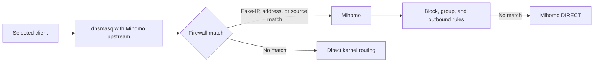

# Traffic Interception

[Documentation](../README.md)

JustClash intercepts connections that match selected addresses, sources, or
Fake-IP ranges. Unmatched connections use the kernel's normal routing.

For the meaning of outbounds, providers, and groups, see
[Configure routing](../guides/routing.md#how-the-components-fit-together).

## Data Path



## Partial Interception

JustClash creates nftables sets from enabled text IP-CIDR rulesets and intercepts:

- connections to configured Fake-IP ranges;
- destinations contained in active IPv4 or IPv6 text sets;
- manually configured destination addresses;
- selected clients matching manual source-address rules.

Earlier firewall bypasses and protocol policies still apply. Interception handles
eligible TCP/UDP connections, not every protocol or local/private destination.

Unmatched real-address connections use the kernel's normal routing. Domains
excluded from Fake-IP can still enter Mihomo through an address or source rule
or an active text IP-CIDR set. Inside Mihomo, `MATCH,DIRECT` sends connections
that miss the preceding rules directly.

The ruleset worker watches active text IP-CIDR files and updates nftables after Mihomo refreshes them. Domain and binary rulesets remain core-side data.

Earlier routing rules and firewall exclusions still take precedence. Explicit
Inbound clients have their own [routing policy](../guides/inbounds.md#routing-policy).

The trade-off is additional userspace processing. Use the supported exclusion
settings for traffic that must stay in the native path.

## What "Direct" Means

There are three paths that can look like "direct internet access":

| Path | Who handles the connection? | How is the outgoing path chosen? |
| --- | --- | --- |
| Traffic outside Mihomo | OpenWrt's normal network stack | System routes and any external policy routing |
| Mihomo's built-in `DIRECT` action | Mihomo | The core's normal direct settings and system routing |
| A named `direct://` outbound | Mihomo | The outbound's own interface, address-family, and optional mark settings |

See [Multi-WAN and Failover](../guides/multiwan.md) to configure
named direct paths and choose between them.

## DNS and Fake-IP

When DNS management is enabled, dnsmasq forwards the relevant requests to Mihomo. Mihomo can return a Fake-IP address, and the following client connection is mapped back to the original domain.

The DNS path and traffic path must agree:

| Client design | DNS result | Traffic path |
| --- | --- | --- |
| Intercepted client | Fake-IP allowed | Must enter JustClash |
| Fully bypassed client | Real addresses | Must remain outside JustClash |
| Partially bypassed domain | Real address | Needs an address or source interception match |

See [Traffic Exclusions](../guides/traffic-exclusions.md) and [Guest Network Configuration](../guides/guest-network.md).

## TProxy, Not TUN

JustClash uses fw4/nftables, policy routing, and TProxy. It does not create a virtual TUN interface.

The managed components are:

1. nftables interception and exclusion rules;
2. IPv4 and optional IPv6 policy-routing tables;
3. Mihomo listeners, DNS, and routing rules.

Stop or reload the service through procd so all three components are updated together.

## Configuration Changes

Saved settings and runtime state are separate. See
[Configuration lifecycle](configuration-lifecycle.md) for Save & Apply, validation,
generated YAML caching, and persistent data.

## Client and Router Traffic

| Traffic source | Main control |
| --- | --- |
| Forwarded clients | **Create nftables** and **Client traffic interfaces** |
| Router processes | The same **Create nftables** switch |
| Selected bypasses | Client address, MAC, port, socket owner, or routing mark |

Mihomo outbound sockets use a dedicated mark to prevent interception loops.

## IPv6

When IPv6 support is enabled and the router has a usable IPv6 WAN:

- JustClash creates IPv6 interception and policy-routing rules;
- JustClash maintains IPv6 sets for supported text IP-CIDR sources;
- IPv6 Fake-IP can be enabled in the generated DNS configuration.

When IPv6 support is disabled or unavailable, IPv6 traffic is not governed by the IPv4 rules. Test IPv4 and IPv6 separately.

## Verify Changes

1. Stop high-volume transfers.
2. Open **Services → JustClash → Setup: Service → Traffic rules**.
3. Review the Fake-IP exclusions and selected client interfaces.
4. Save & Apply.
5. Check **Connections**, **Rules**, and **Service logs**.
6. Run:

```sh
justclash.sh check nft --unsafe
justclash.sh check routes
```

These checks may include local network data. Use `justclash.sh check` when the result will be shared.
