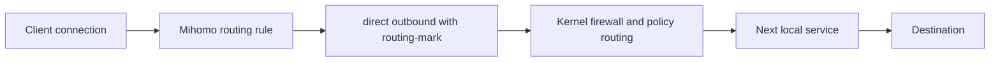

# Pass Traffic to Another Service with fwmark

[Documentation](../README.md)

Use a `direct://` outbound with **Routing mark** when Mihomo should select
traffic and another service on the router should handle its outgoing connections.
The receiving service must already provide firewall or policy-routing rules that
recognize that mark and deliver the connections to its listener or tunnel.



The mark is local kernel metadata. It is not sent to the remote destination and
does not identify an application by itself. JustClash sets the mark on the
outbound connection; the other service's integration determines what happens next.
See Mihomo's [routing-mark setting](https://wiki.metacubex.one/en/config/proxies/#routing-mark).

## Prepare the Receiving Service

Before changing JustClash, configure the other service to:

- Match an unused mark, for example `0x1000000` (`16777216` in decimal).
- Handle connections originating on the router. Rules that only capture incoming
  LAN traffic do not capture Mihomo's locally created outbound sockets.
- Deliver matching traffic to its transparent listener or tunnel, with the
  required routing table, rule priority, and firewall hooks.
- Exclude its own outgoing connections from both interception paths to avoid a loop.

For a TProxy receiver, the listener must support transparent sockets and the
kernel needs the corresponding delivery rules. The exact configuration depends
on the receiving service; use its integration instructions. The
[Linux TProxy documentation](https://docs.kernel.org/networking/tproxy.html)
explains the kernel requirements.

JustClash accepts marks from `1` to `2147483647`, in decimal or hexadecimal.
The internal flags are `4` (`0x4`) for interception and `128` (`0x80`) for Mihomo's
own outbound traffic. Custom marks must leave both bits clear; combinations such
as `5` or `129` also conflict. Also check other installed services for mark and mask conflicts.
Keep their routing tables and priorities coordinated with JustClash's policy routing.

## Configure the Outbound in LuCI

In **Setup: Routing → Proxies**, add an enabled entry:

| Field | Value |
| --- | --- |
| Name | `Next_Service` |
| Mode | `uri` |
| Link | `direct://` |
| Routing mark | `0x1000000`, or the mark configured by the receiving service |
| Bind to interface | Leave empty unless the receiving service requires it |
| Connect through | Leave empty for this setup |

Assign rules to this outbound, or include it in a group and assign rules to that
group. Then choose **Save & Apply**. See [Assign traffic](routing.md#assign-traffic)
for lists, manual rules, and default routing.

In Partial Interception, those rules must also cause the connection to enter
Mihomo. Selecting this outbound as the final rule alone does not capture every
client connection; see [Routing modes](../concepts/routing.md).

### Equivalent UCI Entry

The following creates a named outbound section. Use an unused section ID and an
outbound name that does not already exist:

```sh
uci set justclash.next_service='proxies'
uci set justclash.next_service.enabled='1'
uci set justclash.next_service.name='Next_Service'
uci set justclash.next_service.mode='uri'
uci set justclash.next_service.proxy_link_uri='direct://'
uci set justclash.next_service.routing_mark='0x1000000'
uci commit justclash
service justclash reload
```

This defines the connection path. Assign routing rules or group membership
separately, just as in LuCI.

## How the Two Services Interact

When JustClash creates nftables rules, it collects the UCI `routing_mark` values
from outbounds and `override_routing_mark` values from providers. Matching packets
return from JustClash's output chain in both routing modes. Other firewall chains
and policy-routing rules can still process them.

Each custom mark is matched by its set bits: `(packet_mark & configured_mark) ==
configured_mark`. All bits of that configured mark must remain set; other bits
can change. For example, `0x01000000` still matches `0x41000000` after another
service adds `0x40000000`. Coordinate bit assignments with other services so
unrelated traffic does not match the same flags. The internal flags also use bit
comparisons, and interception assigns `0x4`, replacing the previous packet mark.
JustClash's policy-routing rule uses `fwmark 0x4/0x4`. Another service must
preserve the internal flags and avoid assigning those bits for its own purposes.
Cleanup removes only the current masked rules from JustClash's routing table.
The core configuration cache is invalidated when the internal mark values change.

A `direct://` entry marks connections toward the actual destination. On a remote
outbound, the mark instead applies to the connection toward that outbound's
server. A provider override marks its imported nodes' connections; it does not
select the subscription download path. Groups use their selected member's mark.

For this setup, use the URI entry and its separate **Routing mark** field.
Marks placed only inside a JSON outbound are not collected for the automatic
nftables bypass. Such entries need separately managed loop prevention.

## Verify the Handoff

1. Establish a new connection matching the assigned rule. Under **Connections**,
   confirm that Mihomo selected `Next_Service` or a group containing it.
2. Inspect the generated configuration locally with `justclash.sh config show mihomo`.
   The entry should contain `type: direct` and `routing-mark: 16777216` for the
   example mark; hexadecimal UCI input is normalized to decimal.
3. Use `justclash.sh check nft --unsafe` and `justclash.sh check routes` to inspect the
   JustClash bypass and policy routing. Check the receiving service's rule
   counters and connection view to confirm delivery beyond Mihomo.

If Mihomo selects the entry but the receiving service sees nothing, check its
handling of locally generated traffic, mark/mask match, rule priority, and address
family. A working connection alone does not prove the handoff: without matching
receiver rules, a direct outbound may use ordinary system routing.
