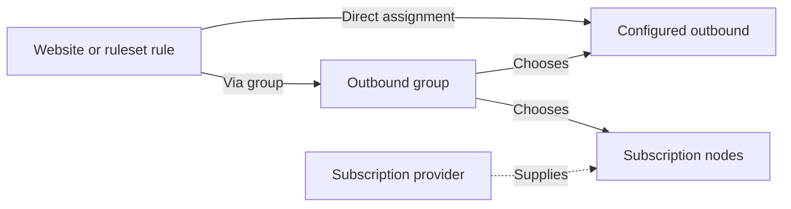
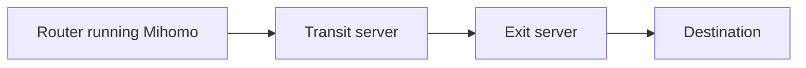

# Configure Outbounds, Providers, and Groups

[Documentation](../README.md)

Use **Services → JustClash → Setup: Routing** to define connection paths and the
traffic assigned to them. If this is your first installation, complete
[Getting started](../getting-started.md) first.

## How the Components Fit Together

| Component | What it defines | Where it is used |
| --- | --- | --- |
| Outbound | One connection link, Mihomo JSON definition, or named direct path | Rules can select it directly; groups can include it |
| Provider | A subscription that supplies and refreshes nodes | Groups include it under **Providers** |
| Group | A set of connections and a method of choosing between them | Rules select the group; **Nodes** selects or inspects its active member |

In LuCI, manually configured outbounds are called **Proxies**. Groups have a
**Proxies** list for individual outbounds or other groups and a **Providers** list
for subscription sources. Both lists can be used together.

A standalone outbound is enough for a fixed route. Groups are usually more
convenient: rules keep pointing to the same group while you replace its members,
switch a subscription node, or add failover. A group does not add a network hop;
[Connect through](#chain-two-outbounds-with-connect-through) is the separate
setting for connection chaining.

## Add an Individual Outbound

Under **Proxies**, add an enabled entry with a unique name. Names used by routing
selectors contain letters, digits, hyphens, or underscores, up to 64 characters.

| Source | Mode | Connection definition |
| --- | --- | --- |
| Connection link | `uri` | Paste the supported link into **Link** |
| Mihomo JSON | `object` | Paste one outbound into **JSON object** |
| Direct through OpenWrt routing or an existing WAN/VPN device | `uri` | Enter exactly `direct://` into **Link** |

Leave **Connect through** and **Routing mark** empty for an ordinary setup. Save
the row before using its name in a group or rule.

### Bind to an Interface

For a URI entry, **Bind to interface** selects an outgoing network device. It is
not an OpenWrt logical network name or firewall zone. This works for both remote
connections and `direct://` entries.

For JSON entries, place Mihomo's `interface-name`, `ip-version`, `routing-mark`,
or `dialer-proxy` fields inside the JSON object. The separate URI controls do not
override that object. A single object wrapped in an array is accepted by LuCI
and normalized when saved.

A `direct://` entry creates a named Mihomo `direct` outbound. It requires no
server, login, port, or URI query parameters. The WAN or system VPN and its routes
must already work in OpenWrt. See [Multi-WAN](multiwan.md) for multiple bound paths.

To send selected connections to another local service through a kernel mark,
follow [direct:// and fwmark](fwmark-handoff.md). The receiving service must
provide the matching firewall or policy-routing integration.

### Chain Two Outbounds with Connect through

Suppose the router can reach a connection named `Transit`, and the final outbound
named `Exit` should establish its server connection through `Transit`.

The routing rule selects **Exit**. Set **Connect through** on **Exit** to
**Transit**. The destination sees the final connection from the Exit server.
This is Mihomo's [dialer-proxy behavior](https://wiki.metacubex.one/en/config/proxies/dialer-proxy/).

1. Under **Proxies**, create an enabled URI entry named `Transit` with its working
   connection link. Leave **Connect through** empty and verify this path works.
2. Create another enabled URI entry named `Exit` with its own connection link.
   Enter `Transit` in **Connect through** and save the row.
3. Create a `select` group named `Chained_Egress`, and add `Exit` under **Proxies**.
   Assign the desired lists or manual rules to this group. A standalone rule
   targeting `Exit` works too.
4. Choose **Save & Apply**. Under **Nodes**, select `Exit` in `Chained_Egress`,
   then establish a new connection matching its rules.

| Entry | Connect through | Role |
| --- | --- | --- |
| `Transit` | Empty | Carries the connection to the Exit server |
| `Exit` | `Transit` | Handles the selected destination traffic |
| `Chained_Egress` | Group has no such field | Selects `Exit` |

Adding both outbounds as group members provides alternative paths; it does not
chain them. To make the transit path switchable, **Connect through** can name a
separate group instead of `Transit`. That group must not contain `Exit` or any
member whose chain leads back to it. Never configure `Transit` to connect
through `Exit` in this example.

Transit must support the transport used to reach the Exit server, including UDP
when that transport requires it. In JSON mode, add `"dialer-proxy": "Transit"`
to the existing Exit object; the separate URI control does not modify JSON.

Under **Connections**, check the matched rule and the outbound chain for `Exit`
and `Transit`. A destination-side address check should show the Exit server's
egress. If Transit works alone but the chain fails, check whether it can reach
the Exit server and carry its transport, then inspect the core error locally.

## Add a Subscription Provider

Under **Proxy providers**:

1. Create an enabled entry and give it a unique name.
2. Paste a Mihomo-compatible subscription into **Subscription URL**.
3. Choose **Get subscription with**. Use `DIRECT` when the source is reachable
   normally, or an already working outbound/group when it needs another path.
4. Keep the download interval and size limit appropriate for the source.
5. Use **Security** only for headers or encryption required by that source.
6. Save the row, then include its name in a group's **Providers** list.

The downloaded nodes do not need separate UCI `proxies` entries. A provider is a
source, not a selectable website route on its own.

**Get subscription with** selects the subscription download path. **Override**
changes connections made by the imported nodes, such as their outgoing device.
Neither field assigns websites to the provider. Avoid a download path that
depends on nodes from the same subscription: they are unavailable before the
initial download.

## Create a Group

Under **Proxy groups**, add an enabled entry, give it a unique outbound name,
and add members under **Proxies**, **Providers**, or both.

| Group type | Selection | Suitable for |
| --- | --- | --- |
| `select` | You choose a member under **Nodes** | Manual switching and a first setup |
| `fallback` | First healthy member in the configured order | Primary/backup paths |
| `url-test` | Measured delay, with the configured tolerance | Automatic delay-based selection |
| `load-balance` | Configured distribution strategy | Spreading separate connections across paths |

For `select`, **Default selected** is on the **Health check** tab. Leave it empty
when you do not yet know a subscription node's exact name, then choose a node
under **Nodes** after startup. The backend allows omitted check fields for
`select`; the current LuCI editor still supplies and requires its check presets.
Keep those presets when editing through LuCI.

For automatic selection, configure a check target reachable through every member.
Provider health checks and group checks are separate. See the
[field reference](../reference/uci.md#proxy_group) and
[failover example](multiwan.md#ordered-failover) for details.

Do not create group membership or connection-chaining cycles. Type validation
does not prove that every referenced name exists or is reachable.

## Assign Traffic

On the outbound or group that should handle the traffic:

- Under **Rulesets → Use with rules**, select existing catalog entries.
- Under **Manual rules**, add domain suffixes, TCP/UDP destination
  ports, destination addresses, or source addresses as needed.
- In Geodata mode, select the relevant Geosite/GeoIP categories.

Enter a domain suffix without a scheme or path; it also matches subdomains.

**UDP destination ports** and **TCP destination ports** accept one port per item,
from `1` to `65535`. Each entry is an independent match for the selected protocol
and destination port; it does not restrict the domain rules in the same section.
These fields only route traffic already received by Mihomo. They do not add
firewall interception in Partial Interception mode.

Within an outbound or group, source-address rules come first, followed by port
rules, domain suffixes, Geosite/domain rulesets, and destination
IP rules.

Assign a rule to either the group or its individual outbound for the same task.
Duplicating it in both places makes the result depend on rule order.

Adding a custom list source is a separate task under **Setup: Rulesets**; see
[Custom rulesets](rulesets.md). Creating an outbound or group without assigning
rules or selecting it as a default does not send traffic through it.

### Default and Mixed Port Rules

**Default rule → Send traffic to** handles connections that reach Mihomo and match
no earlier rule. In Partial Interception it cannot capture an otherwise unmatched
real-address connection. Use [Full Interception](../concepts/routing.md#full-interception)
when the default path must handle all eligible traffic.

**Mixed Port rules** controls explicit HTTP/SOCKS clients separately. `BY RULES`
continues through normal routing; a fixed outbound takes precedence over those
rules. See [Mixed Port routing](mixed-port.md#routing-policy).

Routing rules are generated in this order: fixed Mixed Port handling, address
blocking, groups, individual outbounds, and the final rule. Domain blocking is
implemented through DNS. Within groups and outbounds, section order matters when
matches overlap; put the intended earlier match first within its section type.

## Change or Remove Entries

When deleting an outbound or group in LuCI, JustClash removes matching group
members and selected defaults, clears matching connection-chain references, and
resets affected final, Mixed Port, and subscription/blocklist download targets.
The fallback is `DIRECT`, except Mixed Port returns to `BY RULES`.

Deleting a provider removes it from groups' **Providers** lists. Groups are kept
even when empty; review them and provide a usable member before applying. The
cleanup updates pending LuCI changes and takes effect after **Save & Apply**.

This automatic cleanup applies to deletion in LuCI. It does not rewrite all
references after a manual UCI deletion or rename. Review those references yourself.

## Verify Routing

1. Choose **Save & Apply** and confirm the service runs under **Status**.
2. Open **Nodes** and check the group membership and selected node.
3. Establish a new connection matching the rule.
4. Under **Connections**, inspect the rule and outbound chain.

If the connection stays direct, confirm that the client uses router DNS and an
intercepted interface. Clear an old DNS answer and establish a new connection.
Real-IP exceptions and encrypted client DNS can change interception; follow
[DNS and Fake-IP](dns.md) before changing more rules.
